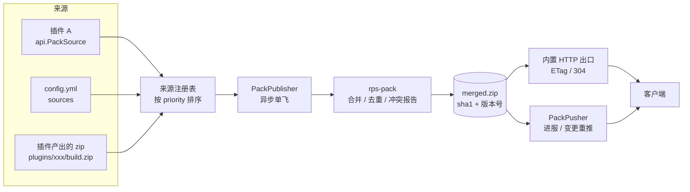

# Resource Pack Service

[](https://github.com/NekoMC-Official/Resource-Pack-Service/actions/workflows/ci.yml)
[](https://github.com/NekoMC-Official/Resource-Pack-Service/actions/workflows/auto-release.yml)
[](https://github.com/NekoMC-Official/Resource-Pack-Service/actions/workflows/codeql.yml)
[](LICENSE)
[](https://papermc.io/software/folia)
[](https://adoptium.net/)
[](https://kotlinlang.org/)
[](https://www.rust-lang.org/)

把多个插件提供的资源包合成**一份**，再由本插件自己通过内置 HTTP 出口和进服推送下发。
不依赖其它下发插件，也不需要手动维护合并后的 zip。

Minecraft 只接受一个服务端资源包。多个插件各发各的，客户端只会保留最后到达的那个，
先到的材质会整包消失。本服务把「谁有什么」和「怎么发」拆开：插件只登记自己产出的
zip，合并、版本、缓存、推送、回执全部由本服务统一处理。

## 特性

- **多来源合成一份包**：按优先级分层，同一路径高优先级覆盖，相同内容自动去重。
- **可合并的 JSON**：`assets/<ns>/lang/*.json` 与 `assets/<ns>/sounds.json` 按键深度合并；
  `assets/<ns>/font/*.json` 与 `assets/<ns>/atlases/*.json` 按数组拼接（高层在前、去重）；其余文件按策略取一份。
- **确定性输出**：相同输入得到逐字节相同的 zip，便于比对 sha1 与缓存。
- **来源变更自动重建**：轮询来源文件的 mtime，变化后异步重建，不阻塞服务器线程。
- **自带下载出口**：JDK 内置 HTTP Server，单文件固定路径，支持 ETag / 304。
- **自带推送**：玩家进服延迟推送，支持 `none` / `notify` / `force` 三种重推策略。
- **回执处理**：加载成功、拒绝、下载失败都会记录；必装包被拒绝时会断开。
- **对外标准 API**：其它插件实现 `PackSource` 并注册即可，不接触任何宿主类型。
- **环境体检**：`/rps check` 检查下载地址、`server.properties` 残留配置、其它插件的疑似推送配置。
- **社区资源包流水线**：PR 自动校验与预览，合并后按绑定关系受控发行；服务端只加载本机已安装插件对应的包。

## 技术栈

| 层 | 技术 | 说明 |
| --- | --- | --- |
| 平台 | Folia 26.3 / Paper API `26.3.build.21-alpha` | `folia-supported: true`，玩家操作走实体调度器 |
| 宿主边界 | Java 25 字节码（JDK 26 toolchain，`--release 25`） | 插件入口、事件、HTTP、推送、对外 API |
| 编排 | Kotlin 2.4.21（`jvmTarget = 25`） | 配置、注册表、发布器、监听、命令、文案 |
| 计算 | Rust 2024（serde / serde_json / sha1 / zip） | `rps-pack` 只做合并，随 jar 内置 |
| 构建 | Gradle 9.9.2 + Shadow 9.6.1 | 产出单个 `resource-pack-service-<版本>.jar` |
| 测试 | JUnit 6.1.3 / cargo test / unittest | Java 92 项（19 个测试类），Rust 26 项（19 项合并集成 + 2 项 mcmeta + 5 项单元），Python 27 项绑定测试 |
| 文本 | Adventure + MiniMessage | 提示语与 `push.notify-message` |

依赖方向是单向的：**Java → Kotlin → Rust**。跨语言边界只传 JDK 类型和 Java record，
不把 Kotlin 默认参数、扩展函数或 `object` 单例暴露给 Java。

## 架构



一次构建只有一条路径：收集来源 → 校验 → 分层 → 合并 → 校验大小 → 落盘 → 递增版本 →
更新下载地址 → 按 `push.mode` 处理在线玩家。构建失败保留上一版，不会把半成品发给玩家。

## 安装

两个版本，按服务端类型装其中一个，不要同时装：

| 服务端 | 产物 | 放到 | 配置 |
| --- | --- | --- | --- |
| Paper / Folia 26.3 | `resource-pack-service-<版本>.jar` | `plugins/` | `plugins/ResourcePackService/config.yml` |
| Fabric 26.3（仅服务端） | `resource-pack-service-fabric-<版本>.jar` | `mods/` | `config/resource-pack-service/config.yml` |

两个版本共用同一套配置键（`provider` / `merge` / `delivery` / `sources` / `watch` / `push` / `community`），文档里的配置示例两边通用。

### Paper / Folia

1. 把 `resource-pack-service-<版本>.jar` 放进服务端 `plugins/`（文件名不影响加载，带版本号便于核对）。
2. 启动一次，生成 `plugins/ResourcePackService/config.yml`。从 0.1.6 起插件名改为无空格的 `ResourcePackService`（Paper 26.x 拒绝带空格的描述符）；首次启动会把旧目录 `plugins/Resource Pack Service` 的内容自动迁移过来。
3. 按需改下载出口与来源，然后 **COLD 重启**（Bukkit 插件不支持热装）。
4. 确认 `server.properties` 里这两项为空：

   ```properties
   resource-pack=
   resource-pack-id=
   ```

   原版会在配置阶段抢先推旧包；`resource-pack-id` 还会派生第二个 UUID，导致客户端装两份。

Paper 版没有任何 `depend` / `softdepend`，可以单独存在。只要同目录没有第二个会
`setResourcePack` 的插件，它就是唯一出口。

### Fabric（仅服务端）

1. `mods/` 里放 `resource-pack-service-fabric-<版本>.jar`，外加 Fabric API（26.3 用 `fabric-api-0.167.0+26.3` 或更新版本）。
2. 需要 Fabric Loader 0.20.1+。Kotlin 运行时、内核与 `rps-pack` 合并器都嵌在 mod 里，服务端不用另装前置；玩家侧什么都不用装（`environment: "server"`）。
3. 首次启动生成 `config/resource-pack-service/config.yml`，默认模板与 Paper 版共用，键名与语义完全一致。
4. `server.properties` 的 `resource-pack=`、`resource-pack-id=` 同样留空。
5. 社区包按**已加载的 mod id** 判断是否适用（对应 Paper 侧的插件判断）；Bukkit 的插件认领事件在 Fabric 上没有等价物，`community-bind` 相关能力不提供，远程索引与手工 `sources` 正常可用。

### 下载地址怎么定

默认开启内置 HTTP：

```yaml
delivery:
  http:
    enabled: true
    bind: 0.0.0.0
    port: 25580
    path: /pack/merged.zip
    public-url: ""
```

- 单机或同网段：保持 `public-url` 为空，服务会按监听地址拼出 `http://<ip>:25580/pack/merged.zip`。
- 公网 / NAT / 反向代理：填**完整可访问地址**，例如
  `public-url: "https://mc.example.com/pack/merged.zip"`。填了就以它为准，不再看 bind。
- 只用 CDN 或对象存储：把 `http.enabled` 设为 `false`，只填 `public-url`；推送仍然可用，
  但文件需要你自己同步到那个地址。

> 地址不是秘密：客户端必须能直接 GET。不要在 URL 里放长期凭据。

## 快速开始

```yaml
sources:
  - id: "bettermodel/base"
    enabled: true
    path: "plugins/BetterModel/build.zip"
    priority: -100
    namespaces: ["bettermodel"]

community:
  enabled: true
  dir: "plugins/ResourcePackService/community"
  priority: 0
  remote:
    enabled: true
    index-url: "https://nekomc-official.github.io/Resource-Pack-Service/community-index.json"
```

`path` 相对服务端根目录。`priority` 越大越靠上层；同一路径冲突时上层覆盖下层。
同优先级按登记顺序入层，后登记的在上；`policy: first` 时反过来保留先登记的。`namespaces` 只用于 `/rps list` 展示与冲突提示，不改变合并结果。

改完执行：

```text
/rps reload
/rps status
/rps list
/rps diff
```

## 配置

| 键 | 默认 | 说明 |
| --- | --- | --- |
| `provider.required` | `false` | **服务端**强制策略：`true` 时玩家拒绝资源包会被按 `reject-message` 断开。它不改变客户端弹什么框——弹不弹由玩家在该服务器条目的「Server Resource Packs」（提示 / 已启用 / 已禁用）决定 |
| `provider.announce-required` | 跟随 `required` | 是否把“必需”标记随包发给客户端。`true`：即使档位为「已禁用」也会弹必装框（Proceed / Disconnect），拒绝时客户端先用它自己的文案断开；`false`：一律可选（Yes/No），拒绝后由 `required` 决定是否断开 |
| `provider.prompt` | 空 | 下载界面显示的一句提示 |
| `provider.reject-message` | 内置文案 | `required` / `announce-required` 生效且客户端拒绝时的断开原因，MiniMessage；留空使用内置自解释文案（`announce-required: true` 时客户端会先自己断开，本文案只作服务端兜底） |
| `merge.policy` | `override` | 路径冲突策略：`override` / `strict` / `first` |
| `merge.rust.binary` | `bin/rps-pack` | 合并器路径；留空或不存在时用 jar 内置的那份 |
| `merge.rust.timeout-ms` | `60000` | 单次合并超时，最小 5000 |
| `merge.json-merge` | `true` | 是否合并 lang / sounds.json（按 key 深合并）与 font / atlases（数组拼接），均限 `assets/<ns>/` 下的同名 JSON |
| `merge.pack-format` | `auto` | `auto` 取所有子包都能接受的交集；也可写具体格式号 |
| `merge.max-bytes` | `104857600` | 合成包大小上限，超过则本次构建失败并保留上一版 |
| `merge.description` | `NekoMC 统一资源包` | 写进 `pack.mcmeta` 的 description |
| `output.dir` | `merged` | 相对插件数据目录，存放 `merged.zip` 与条目清单 |
| `community.enabled` | `true` | 是否加载社区资源包目录 |
| `community.dir` | `plugins/ResourcePackService/community` | 社区包目录，内含 `manifest.json` 与各包 zip |
| `community.priority` | `0` | 社区包的层序偏移，叠加在各包自己的 `priority` 上 |
| `community.minecraft` | 空 | 服务端 Minecraft 版本；空表示不额外限制，由各包的 `minecraft` 范围决定 |
| `community.pack-format` | 跟随 `merge.pack-format` | 服务端资源包格式。留空时若 `merge.pack-format` 是具体数字就沿用，否则为 `0`；`0` 表示不按格式过滤，交给合成阶段取各包格式范围的交集 |
| `community.remote.enabled` | `false` | 是否定时拉取 Pages 索引并按需下载社区包 |
| `community.remote.index-url` | Pages 索引地址 | `community-index.json` 的完整 URL |
| `community.remote.interval-minutes` | `60` | 索引检查间隔，最小 5 分钟 |
| `community.remote.timeout-ms` | `30000` | 单次 HTTP 请求超时，1000–300000 |
| `community.remote.max-pack-bytes` | `67108864` | 单个社区包的大小上限 |
| `community.remote.require-https` | `true` | 拒绝非 HTTPS 的索引与包地址 |
| `community.remote.pin-sha1` | 空 | 固定索引内容的 SHA-1 / SHA-256，防止索引被替换 |
| `delivery.join-delay-ticks` | `1` | 进服后延迟多少 tick 推送 |
| `delivery.status-feedback` | `true` | 是否把加载/拒绝结果回显给玩家 |
| `delivery.fanout.max-concurrent` | `64` | 同时在途的推送上限（窗口上限），1–1024 |
| `delivery.fanout.jitter-ms` | `1500` | 进服推送的随机抖动上限，0–10000 |
| `delivery.fanout.retry` | `1` | 单次推送失败后的重试次数，0–3（间隔 5 秒） |
| `delivery.fanout.ramp` | `true` | 是否按失败率自动升降窗口：每 5 秒检查一次、样本 ≥8 才生效（>2% 减半、<1% +25%）；关闭时直接用上限 |
| `delivery.http.enabled` | `true` | 是否启动内置 HTTP 出口 |
| `delivery.http.bind` | `0.0.0.0` | 监听地址 |
| `delivery.http.port` | `25580` | 监听端口；`0` 表示随机端口（启动日志会打印实际值） |
| `delivery.http.path` | `/pack/merged.zip` | 固定下载路径 |
| `delivery.http.public-url` | 空 | 完整公网地址；填了优先使用 |
| `delivery.http.max-concurrent` | `64` | 同时在途的下载上限，1–256；占满时新请求直接 503 + `Retry-After: 1` |
| `delivery.http.egress-kbps` | `0` | 出口全局限速（KB/s），0–10000000；0 表示不限，开启后在途超时放宽到 1 小时 |
| `watch.enabled` | `true` | 是否轮询来源文件 |
| `watch.interval-seconds` | `60` | 轮询间隔，最小 5 |
| `push.mode` | `notify` | 内容变化后：`none` 只落盘 / `notify` 提示玩家 / `force` 强制重推 |
| `push.notify-message` | 见默认配置 | MiniMessage，默认带 `/rps push` 可点击提示 |

`push.mode` 只影响**内容真的变化**的那一次构建。相同内容重复构建会跳过重推，
避免玩家白白重下整包。

`delivery.fanout.*` 作用于进服推送、内容变化后的批量推送，以及 `/rps push` 的全体路径（含控制台无参形式）：
普通推送会跳过已加载同一 SHA-1 的玩家，退服立即释放窗口，在途超过 120 秒记为失败；
`push.mode: force` 与手动全体推送传空 SHA-1，不跳过已加载玩家。`/rps push <玩家>` 单人推送仍直接发包。

### `provider.required` 的作用范围

`provider.required` 是**全局开关**：对所有来源、所有玩家、所有推送路径（进服、内容变化通知、
`/rps push`、API `push`）一起生效，与是哪个插件登记了来源无关，也不存在“只对某个包必装”的配置。

| `push.mode` | 构建后发现内容变化 | 与 `required` 的关系 |
| --- | --- | --- |
| `none` | 只落盘，不通知也不重推 | 玩家下次进服仍会推送，`needed` 由 `required` 决定 |
| `notify` | 给在线玩家发 `push.notify-message`，玩家自己点提示重载 | 同上 |
| `force` | 内容变化后排队重推所有在线玩家（已加载同一 SHA-1 的仍跳过；内容未变不触发，见上） | 只表示“立即重推”；不会把包标成必需（推送时客户端的 `required` 恒为 `false`），必需性由服务端在收到 `DECLINED` 后按 `provider.required` 执行 |

`required: false` 时，玩家拒绝后只是记录 `DECLINED`，**下次进服仍会再推一次**（服务端不保存
“永不再推”的标记）；`required: true` 时拒绝会在玩家实体调度器上按 `provider.reject-message` 断开，
下次进服同样会再推。

## 命令与权限

| 命令 | 作用 | 权限 |
| --- | --- | --- |
| `/rps` | 显示可用命令 | `rps.use` |
| `/rps status` | 当前版本、sha1、下载地址、构建状态、下发方式 | `rps.status` |
| `/rps list` | 已登记来源、优先级、命名空间 | `rps.list` |
| `/rps build` | 立即触发一次合成 | `rps.build` |
| `/rps reload` | 重载配置并重新合成 | `rps.reload` |
| `/rps push` | 玩家给自己重载；控制台推全部在线玩家 | `rps.use`（玩家自助） |
| `/rps push <玩家>` | 给指定玩家推送 | `rps.push` 或 `rps.admin` |
| `/rps check` | 检查下载地址、`server.properties`、其它插件的疑似推送配置 | `rps.check` |
| `/rps diff` | 对比本次与上次的条目差异 | `rps.diff` |
| `/rps conflicts` | 看材质、模型、方块状态等冲突；`all` 查看语言、声音、字体、图集 | `rps.use` |
| `/rps rejected [条数]` | 最近的玩家资源包状态（谁、何时、状态、sha1 前 8 位） | `rps.status` |
| `/rps community` | 查看社区目录、已纳入数量与远程索引状态 | `rps.community` |
| `/rps community update` | 立即拉取一次远程索引并按需下载 | `rps.community` |

`rps.use` 默认对所有玩家开放，因为默认提示语里的「点这里重新下载」需要玩家能执行
`/rps push`。其余节点默认 `op`，可用权限插件逐项分配；`rps.admin` 是
`build` / `reload` / `push` / `check` 的集合。

## 给插件作者：登记资源包来源

依赖本插件的 API（编译期 `compileOnly`）。服务已提供下面这个接口，你只需要实现它：

```java
package moe.nekomc.resourcepack.api;

public interface PackSource {
    String id();                 // 全局唯一，建议 "插件名/用途"
    java.nio.file.Path file();   // 每次构建时读取的 zip
    int priority();              // 越大越靠上层
    default boolean enabled() { return true; }
    default String sha1() { return null; }          // null 表示由服务计算
    default java.util.List<String> namespaces() { return java.util.List.of(); }
    default String version() { return ""; }         // 仅用于展示，不参与合并顺序
}
```

注册与注销：

```java
import java.nio.file.Path;
import java.util.List;
import moe.nekomc.resourcepack.api.PackSource;
import moe.nekomc.resourcepack.api.ResourcePackService;

ResourcePackService service = getServer().getServicesManager()
        .load(ResourcePackService.class);

PackSource source = new PackSource() {
    public String id() { return "myplugin/cosmetics"; }
    public Path file() { return getDataFolder().toPath().resolve("pack.zip"); }
    public int priority() { return 100; }
    public List<String> namespaces() { return List.of("myplugin"); }
};

service.register(source);
// onDisable: service.unregister("myplugin/cosmetics");
```

- `register` 会立即触发一次异步重建；来源文件还没生成时构建会失败并保留上一版，
  等文件就绪后再调一次 `service.rebuild(false)` 即可。
- `unregister(id)` 后同样会重建。插件 `onDisable` 里记得注销。
- 版本号由服务统一递增，来源不要自己拼 `?v=`。
- 只合并本地 zip；远程 URL 请先下载到本地再注册。
- 你的 zip 可以不带 `pack.mcmeta`：没有就视为不限制 `pack_format`，条目照常合入。
  带了则参与格式交集计算。命名空间放 `assets/<你的命名空间>/`，避免与他人撞车。
- 不要自己调用 `Player#setResourcePack`，也不要另开推送通道；客户端只保留一个包。

不写代码的接入方式、目录打包、远程 URL、冲突处理，见 [docs/integration.md](docs/integration.md)。

### 运行时状态、构建结果与事件（0.1.6+）

这组接口只增不改，旧实现类不需要改动即可编译。异步方法叫 `rebuildAsync`，因为 Java
不能只按返回类型重载已有的 `rebuild(boolean)`。

```java
ResourcePackService service = getServer().getServicesManager()
        .load(ResourcePackService.class);

// 发起重建并等待结果；同一时刻只跑一次，重复请求会合并到下一轮。
BuildResult built = service.rebuildAsync(true).join();
if (built.ok()) {
    getLogger().info("包已更新: " + built.sha1() + " v" + built.version()
            + " (" + built.entryCount() + " 项, " + built.bytes() + " 字节)");
} else {
    getLogger().warning("构建失败: " + built.error());
}

// 当前快照：sha1 与客户端实际下载的 merged.zip 逐字节一致，url 可直接 GET。
BuildResult current = service.snapshot();
String lastError = service.lastError();          // 成功时为 null

// 每个玩家的状态；未知或已离线玩家返回 UNKNOWN，不会返回 null。
UUID id = player.getUniqueId();
PackStatus status = service.status(id);           // UNKNOWN/PENDING/LOADED/DECLINED/FAILED/INVALID_URL
String loadedSha1 = service.hashOf(id);           // 加载成功时用的 sha1，否则 null
```

监听状态变化：

```java
import org.bukkit.event.EventHandler;
import org.bukkit.event.Listener;
import moe.nekomc.resourcepack.api.PackStatusEvent;

public final class PackListener implements Listener {
    @EventHandler
    public void onPackStatus(PackStatusEvent event) {
        // 事件在该玩家的 Folia 实体调度器上触发；这里只做轻量记录。
        getLogger().info(event.playerId() + " -> " + event.status());
    }
}
```

`BuildResult` 的 `error` 为 `null` 表示成功；失败时保留上一次成功构建的
`sha1` / `version` / `url` / `entryCount` / `bytes`，只替换 `error`。
`PackStatusEvent` 不参与取消，描述的是客户端已经返回的回执。

下游插件需要编译期依赖时，直接用插件 jar 即可：`moe.nekomc.resourcepack.api` 下的接口、
record 与事件（`ResourcePackService`、`BuildResult`、`PackStatus`、`PackStatusEvent`、`PackSource`）
都已经打进插件本体，不再单独发行 API jar。

```kotlin
dependencies {
    compileOnly(files("libs/resource-pack-service-0.1.0.jar"))
}
```

Release 只提供这一个 jar：编译期当依赖，运行期放进服务端 `plugins/`，两者是同一个文件。

## 合并规则

1. 来源按 `priority` 升序排列，低优先级先入层，高优先级后入层。
2. 同一路径：
   - sha1 相同 → 去重，只留一份；
   - 不同 → `override` 取最高层；`first` 取最低层；`strict` 直接失败并报冲突。
3. 可合并 JSON：`assets/<ns>/lang/*.json`、`assets/<ns>/sounds.json` 按键深度合并；
   `assets/<ns>/font/*.json`、`assets/<ns>/atlases/*.json` 的数组按「高层在前」拼接并去重。
4. `pack.mcmeta` 不复制任何一份，统一重建：`pack_format` 取所有子包都能接受的交集，
   `description` 用 `merge.description`。
5. 输出条目按路径升序、时间戳固定为 1980-01-01，保证相同输入逐字节相同。

## 关于「增量更新」

Minecraft 原版协议没有资源包增量下载：客户端只会对整包发一次 GET，没有 Range、
没有 delta、没有断点续传。`setResourcePack` 的 sha1 参数只用于「本地已有同 hash 的包
就跳过下载」。因此能做的只有三件事：

1. **内容寻址**：sha1 不变就不重推，玩家不会重复下载。
2. **把高频变更挪出包外**：配方、进度、函数放 datapack；需要频繁换外观的用
   `custom_model_data` 预留材质槽，而不是每次重打整包。
3. **压体积**：合并时去重、压缩纹理、删掉未引用的文件。

`/rps conflicts` 默认只列材质、模型、方块状态等会直接影响外观的冲突，`/rps conflicts all`
再看语言、声音、字体与图集；完整明细落在 `plugins/ResourcePackService/conflicts.json`。
`/rps diff` 给出条目级变化，用来判断这次改动是否值得让全服重下；`merge.max-bytes`
防止误把大文件塞进来。真正的增量只能靠客户端 mod，服务端插件做不到。

## 内置下发

- `PackHttpServer` 只服务一个固定路径，支持 `ETag` 与 `304 Not Modified`；
  其它路径 404，非 GET/HEAD 405。固定 8 个守护线程处理并发下载。
- `PackPusher` 监听 `PlayerJoinEvent`，按 `delivery.join-delay-ticks` 在该玩家的
  Folia 实体调度器上调用 `setResourcePack`；sha1 为空时走 3 参重载，避免空哈希。
- 监听 `PlayerResourcePackStatusEvent`：成功、拒绝、下载失败、无效地址分别记录；
  `provider.required: true` 时拒绝会在玩家调度器上断开，避免在主线程碰实体。
- 内容变化后按 `push.mode` 处理在线玩家：
  - `none`：只更新文件与状态；
  - `notify`：发一条可点击的提示，玩家自己执行 `/rps push`；
  - `force`：直接对所有在线玩家强制重推。

本插件不监听其它插件的推送，也不与它们协商。若同目录还有插件直接
`Player#setResourcePack`，后发者会覆盖前一个包——这是客户端行为，服务端无法仲裁。
`/rps check` 会扫描 Paper 的 `plugins/*/config.yml` 与 Fabric 的 `config/*.toml`
里疑似 `resource-pack` / `pack-url` / `send-on-join` 的配置并给出警告。

## 社区资源包与受控发行

`packs/` 是社区资源包目录。每个子目录一个包，并且必须声明它和哪个插件、以什么关系绑定：

```text
packs/
└── seasonal/
    ├── pack.yml          # 元数据，不会打进客户端 zip
    ├── pack.mcmeta
    ├── pack.png          # 可选图标
    └── assets/<namespace>/...
```

绑定字段是扁平 YAML，不接受嵌套：

| 字段 | 作用 |
| --- | --- |
| `plugin` | 绑定的插件 id；standalone 写 `universal` |
| `relation` | `official` / `addon` / `patch` / `integration` / `standalone` |
| `release` | `auto` / `manual` / `none` |
| `also` | `integration` 同时服务的其它插件 |
| `variant` / `default` | 同一插件的互斥变体组与默认项 |
| `version` | 内容版本；包内文件有实质变化时递增，便于审计与排查 |
| `minecraft` | 兼容的 Minecraft 版本范围，支持空格 AND、逗号 OR；留空表示不限 |
| `requires` | 依赖插件的版本范围，运行期按已安装插件版本判断 |
| `priority` | 合并层序，越大越靠上 |

- 提 PR：`pack-pr` 用基础分支的脚本校验目录、绑定字段、路径穿越、大小与条目数，生成预览目录，把绑定表、sha1、冲突与未纳入原因写进置顶评论；PR 代码不会被执行。
- 合并进 `main`：不会因为“多了一个包”就自动发行。`auto-release` 先做发行计划：新增的 `release: auto` 包必须由维护者手动触发一次并在 `force_packs` 里点名批准；只新增包、没有代码变更时发行计划返回 `false`，后续构建与发布步骤全部跳过。代码有变更时只发行插件 jar，不生成 `community-packs.zip`、不部署 Pages；包也有变更或 `force_packs` 点名时才走资源包发行，未批准的包不进入 `community-packs.zip`。已有包被删除或改为 `release: none` 时，发行计划会把索引标为需要更新，并发布一个可能为空的索引，避免远程继续提供已撤下的包。
- 已批准且 `release: auto` 的包，后续改动才会自动进入发行；`release: manual` 只在手动发行时进入，`release: none` 只做校验并在报告里列为未纳入，不进入预览包或发行包。
- 离线使用：从 Release 下载 `community-packs.zip`，解压到插件数据目录下的 `community/`：

```text
plugins/ResourcePackService/community/
├── manifest.json
├── companion-base.zip
├── bettermodel-base.zip
└── ...
```

每个包的文件名必须是 `<id>.zip`，`manifest.json` 里的 `packs` 记录每个包的 `plugin`、`relation`、`version`、`minecraft`、`format_min` / `format_max` 等字段。

- 托管索引：Auto Release 会把本次已批准的资源包同步发布到 GitHub Pages，索引地址为
  `https://nekomc-official.github.io/Resource-Pack-Service/community-index.json`。索引里的 `file` 是相对路径，指向内容寻址的 `objects/<sha1>.zip`。
- 远程消费：把 `community.remote.enabled` 设为 `true`（默认关闭）。服务端会定时拉取索引，先按本机已安装插件与 Minecraft 版本筛选，有效的 `community.pack-format` 非 0 时再按包格式过滤（留空会沿用 `merge.pack-format` 的具体数字）；随后按 sha1 增量下载到社区目录，只有全部下载与校验都通过才整体切换到新清单，任一环节失败都保留旧清单与旧包。`/rps community update` 可立即检查一次。

  然后确认配置：

```yaml
community:
  enabled: true
  dir: "plugins/ResourcePackService/community"
  priority: 0
  remote:
    enabled: true
    index-url: "https://nekomc-official.github.io/Resource-Pack-Service/community-index.json"
```

  社区包不需要写进 `sources`。服务启动、`/rps reload` 以及插件启停时都会重新计算绑定：只纳入声明插件已安装并启用的包，`addon` / `patch` 还要求同插件的 `official` 也在候选里，`integration` 要求主插件与 `also` 里每个插件都满足条件。被跳过的包与原因会写进日志，`/rps status` 与 `/rps list` 可核对。

详见 [packs/README.md](packs/README.md) 与 [docs/ci.md](docs/ci.md)。

## 从源码构建

需要 JDK 26、Gradle wrapper 和 Rust（`cargo` 在 PATH，或位于 `~/.cargo/bin`）：

```bash
./gradlew build
```

产物：

- `paper/build/libs/resource-pack-service-<版本>.jar`：Paper / Folia 插件。
- `fabric/build/libs/resource-pack-service-fabric-<版本>.jar`：Fabric 服务端 mod，内含 `:core`、Kotlin 运行时、SnakeYAML 与同一份 `rps-pack`。

两个文件名都带 Gradle `version`（CI 用 `-Pversion=` 注入，本地缺省 `0.1.0`）。

每个产物都是**单个 jar**：`moe.nekomc.resourcepack.api` 接口已打在本体内，下游插件编译期依赖与运行期部署用的是同一个文件，不再有独立的 api jar，也不再保留 plain jar。

`rps-pack` 按构建机平台选一份塞进 jar（Windows / Linux / macOS × x86_64 / aarch64）。
**在 Windows 上打的包内置的是 Windows 合并器，不能直接部署到 Linux 服务端**；
跨平台发布请用 `release.yml` 的矩阵构建，或在目标平台本地构建。

没有 `cargo` 时 Java 部分仍能编译，但 jar 内没有合并器，运行时会报
「合并器不可用」并保留上一版；发布用的 jar 必须在有 Rust 的机器上打。

## 目录结构

```text
core/src/main/java/moe/nekomc/resourcepack/
  api/                             对外标准 API（纯 JDK 类型）
  core/ delivery/ merge/ pack/     引擎配置、状态存储、合并器调用、来源注册表、冲突扫描
  platform/                        ConfigSource / Scheduler / PlayerRef / PackDelivery 端口
core/src/main/kotlin/moe/nekomc/resourcepack/
  command/ config/ core/ merge/ pack/ watch/   编排层，不依赖任何服务端平台
paper/src/main/{java,kotlin}/moe/nekomc/resourcepack/
  ResourcePackServicePlugin.java   Paper 入口、服务注册、生命周期
  platform/                        Bukkit / Folia 适配（配置、调度、玩家、命令桥）
fabric/src/main/java/moe/nekomc/resourcepack/fabric/
  RpsFabricMod.java                Fabric 入口（DedicatedServerModInitializer）
  FabricPlatform.java              PackHost + CommandHost 实现
  FabricPackDelivery.java          发包、回执状态、必装断开
  mixin/                           回执钩子（ServerCommonPacketListenerImpl）
rust/rps-pack/                     Rust 合并器与集成测试
tools/packs.py                     社区资源包校验、打包、bundle 与索引生成
packs/                             社区资源包
```


- [docs/design.md](docs/design.md)：架构、契约、合并语义、里程碑与风险
- [docs/integration.md](docs/integration.md)：四种接入方式与冲突处理
- [docs/ci.md](docs/ci.md)：CI、发布、部署与社区资源包流水线
- [packs/README.md](packs/README.md)：社区资源包规范
- [CONTRIBUTING.md](CONTRIBUTING.md)：DCO、分支、测试与评审

## 贡献

采用 DCO 1.1，提交时加 `-s`：`git commit -s`。不需要签 CLA。细节见
[CONTRIBUTING.md](CONTRIBUTING.md)。

`main` 已开启分支保护：PR 合并前必须由仓库管理者（见
[.github/CODEOWNERS](.github/CODEOWNERS)）审核通过，并通过 CI 与 CodeQL；禁止强制推送与删除分支。

## 许可

[MIT](LICENSE)，Copyright (c) 2026 Sakana07X。

第三方材质、模型、音效的版权仍归各自作者；把资源包放进本仓库或对外分发前，
请确认你拥有相应许可。
