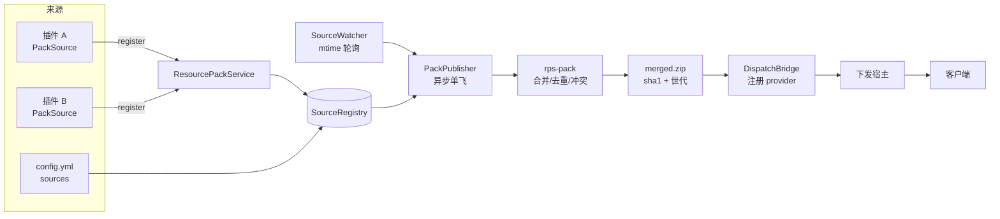

# Resource Pack Service

把多个插件的资源包合并成一份，交给服务器已有的下发宿主统一推送。

Folia 26.3 / Java 25 / Paper API 26.3。本插件负责"包里有什么"与"怎么合"，把合成结果登记给下发宿主；变更后的重推由本插件触发，
实际的 `setResourcePack` 与进服自动同步由下发宿主执行。对外标准是本服务自己的 `PackSource` / `ResourcePackService`，
接入方不需要接触宿主 API。

## 技术栈

| 层 | 选型 | 说明 |
|---|---|---|
| 服务端 | Folia 26.3 | 编译依赖 Paper API `26.3.build.21-alpha`；`folia-supported: true`，触碰玩家一律走实体调度器 |
| 运行时 | Java 25 | 字节码目标 25；构建机用 JDK 26 toolchain |
| 宿主层 | Java | Bukkit 生命周期、对外 `api` 接口、反射桥接；不含编排逻辑 |
| 编排层 | Kotlin 2.4.21 | 配置解析、命令树、状态报告；与 Java 同为 JVM 25 目标 |
| 计算层 | Rust（edition 2021） | `rps-pack`：zip 读写、JSON 深合并、sha1、`pack.mcmeta` 重建；依赖 `serde`、`serde_json`、`sha1`、`zip` |
| 构建 | Gradle 9.5.1 + Shadow 9.6.1 | 自带 wrapper；产物是含 Kotlin 标准库与合并器的 fat jar |
| 测试 | JUnit 5.11.4 + `cargo test` | Java 27 项、Rust 15 项 |
| 配置 / 消息 | YAML + MiniMessage | Bukkit 配置 API；Adventure 渲染命令输出 |

跨语言边界只传 JDK 类型与 Java record，Rust 侧通过 stdin/stdout 的 JSON 协议通信，不走 JNI。

## 架构



- **单飞**：同一时刻只允许一次构建，重复触发合并成一次；构建在异步线程，结果原子替换。
- **失败保旧**：合并失败、来源缺失、二进制不可用都保留上一版 `merged.zip`，不会把玩家推回原版材质。
- **换代**：内容不变不换代、不重推；内容一变按整包算 sha1，客户端重下整包（协议层没有增量）。

目录：

```text
src/main/java/moe/nekomc/resourcepack/   Java 宿主层（api、bridge、pack、merge、watch）
src/main/kotlin/moe/nekomc/resourcepack/ 编排层（command、config）
rust/rps-pack/                           合并器，可独立当 CLI 用
docs/                                    设计与接入文档
```

## 为什么需要它

服务端一次只能给客户端下发一个资源包。当模型、家具、音效包各自想发包时，后注册的会把先注册的顶掉。
本插件把这些来源按层序合成一个 zip，只登记一个 provider。

## 构建

需要两项工具：

- **JDK 26**：Gradle toolchain 会解析本机 Zulu 26；字节码仍按 25 输出。
- **cargo**：在 `PATH` 或 `~/.cargo/bin` 均可。

```sh
./gradlew build
```

产物：

| 产物 | 用途 |
|---|---|
| `build/libs/resource-pack-service.jar` | 装进 `server/plugins/`，已包含 Kotlin 标准库与当前平台的 `rps-pack` |
| `build/dist/bin/rps-pack(.exe)` | 合并器原始二进制，可单独调用或放到 `merge.rust.binary` |

没有 cargo 时构建仍能完成，但 **jar 里不会有合并器**：插件启动后构建资源包会直接报错，不会静默降级。
要发布可用的 jar，就在有 cargo 的机器上打包；目标平台与构建机不一致时，需在目标平台（或 CI）上重新 `cargo build --release`。

## 安装

1. 把 jar 放进 `server/plugins/`，与下发宿主插件同目录（通过它的服务接口接入）。
2. 启动一次，生成 `plugins/Resource Pack Service/config.yml`。
3. 填 `output.public-url`（必须是客户端能访问到的完整地址）。
4. `server.properties` 的 `resource-pack` 与 `resource-pack-id` 保持留空。
5. 重启生效（COLD 插件）。

## 命令与权限

命令节点全部交给权限插件（LuckPerms 等）管理，默认只给 OP。`/rps` 入口要求 `rps.use`，
子命令各一条节点；`rps.admin` 是管理组（等价于 build/reload/push/check），`rps.*` 为通配。

| 命令 | 权限节点 | 默认 | 说明 |
|---|---|---|---|
| `/rps`、`/rps help` | `rps.use` | op | 命令入口，帮助按实际权限裁剪 |
| `/rps status` | `rps.status` | op | 下发状态、世代号、下发权归属 |
| `/rps list` | `rps.list` | op | 来源清单与层序 |
| `/rps diff` | `rps.diff` | op | 最近两版合成包的条目差异 |
| `/rps build` | `rps.build` 或 `rps.admin` | op | 立即重建 |
| `/rps reload` | `rps.reload` 或 `rps.admin` | op | 重读 config.yml 并立即重建 |
| `/rps push <玩家>` | `rps.push` 或 `rps.admin` | op | 对单个在线玩家重推 |
| `/rps check` | `rps.check` 或 `rps.admin` | op | 体检：路径、格式区间、server.properties、下发权归属、疑似自带下发的插件配置 |

没有权限的子命令不会出现在 Tab 补全与帮助里，执行时提示会写明缺哪个节点。

## 给插件作者：让自己的资源包接进来

先分清两种情况。绝大多数插件走 A，**不用改本插件，也不用等发行**。

### A. 实现本服务的 `PackSource`（推荐，不用改本插件）

服务启用后会把 `ResourcePackService` 注册到 Bukkit Services。你的插件实现一个来源并登记即可：

```java
ResourcePackService service = Bukkit.getServicesManager().load(ResourcePackService.class);
if (service != null) {
    service.register(new PackSource() {
        public String id() { return "yourplugin"; }        // 全局唯一，建议插件名小写
        public Path file() { return getDataFolder().toPath().resolve("build.zip"); }
        public int priority() { return 10; }               // 越大越靠上层
        public String sha1() { return null; }              // 可给声明值，null 表示不校验
        public List<String> namespaces() { return List.of("yourplugin"); }
    });
}
```

- 接口只有 [api/PackSource.java](src/main/java/moe/nekomc/resourcepack/api/PackSource.java)
  与 [api/ResourcePackService.java](src/main/java/moe/nekomc/resourcepack/api/ResourcePackService.java)
  两个文件，全是 JDK 类型，不含任何宿主插件类型。
- 登记会触发一次异步重建；`service.push(uuid, force)` 对在线玩家立即重推。
- 内容变了用同一个 `id` 再 `register` 一次即可覆盖；版本号由本服务按合成结果统一递增。
- zip 自带 `assets/<你的命名空间>/`，不要往别人的命名空间塞文件；`pack.mcmeta` 可有可无，
  有则参与 `pack_format` 交集计算，没有视为"不限制格式"。
- 合成包的登记与推送由本服务统一处理，接入方不需要知道谁在推，也不需要自己调 `setResourcePack`。
- 建议在 `onDisable` 里 `service.unregister(id)`：来源指向的文件被删掉会让下次构建失败并保留旧版合成包。

### B. 想让来源开箱即用（提 PR）

例如运行时在 `plugins/YourPlugin/build.zip` 生成资源包，又不想让运维手写配置。想让它成为本项目默认支持的一项：

1. Fork `NekoMC-Official/Resource-Pack-Service`，从 `main` 开分支 `feat/source-<插件名>`。
2. 在 `src/main/resources/config.yml` 的 `sources:` 下加默认条目（`id`、`path`、`priority`）。
3. 产出时机特殊（重载重写、异步生成）就在 `watch/` 补钩子，或说明为什么轮询够用。
4. 加测试：`src/test/java/.../merge/` 用最小 zip 验证你的条目能合入且不覆盖坏他人内容。
5. `./gradlew build` 与 `cargo test`（`rust/rps-pack`）必须全绿，更新 `docs/design.md` 来源表。
6. PR 描述写清：插件名与版本、产出路径、是否自带 `pack.mcmeta`、`pack_format` 范围、
   重写时机、命名空间、期望优先级、是否需要 `required`。

评审通过后合入 `main`，随**下一个发行版本**发布（默认 MINOR 递增）。等不及发行也没关系：
运维方在你插件的配置里本地加一条 `sources` 就立即生效。

提 PR 即表示你同意 [DCO 1.1](CONTRIBUTING.md#贡献者协议dco)（提交加 `-s` 即可），
代码按 [MIT](LICENSE) 发布。完整流程与测试要求见 [CONTRIBUTING.md](CONTRIBUTING.md)。

### 合并规则（写包前先看）

- 上层覆盖下层同名条目；`lang/*.json`、`sounds.json`、`font/`、`atlases/` 按 key 深合并。
- 每层 `pack.mcmeta` 丢弃后重建：`pack_format` 取所有来源都能接受的交集，描述取配置值。
- `sha1` 按整个合成包计算；任一来源变更 → 整包换代 → 客户端重下整包（协议层没有增量）。
- 冲突不静默：`/rps build` 的控制台输出与 `MergeResult.conflicts` 会列出被覆盖的路径。

## 部署

1. `./gradlew build` → `build/libs/resource-pack-service.jar`（内含构建机平台的 rps-pack）。
2. 只把 jar 放进 `server/plugins/`；首次启动自动解出合并器到 `plugins/Resource Pack Service/bin/`。
   换平台（如 Linux x86_64 / aarch64）需在该平台构建，或用 `merge.rust.binary` 指向外部可执行文件。
3. `server.properties` 的 `resource-pack` 与 `resource-pack-id` 必须留空，由下发宿主独占。
4. 需要重启才生效（COLD）；`/rps reload` 只重读配置不换 jar。

## 当前进度

- 已完成：对外标准 API（`api/PackSource`、`api/ResourcePackService`）、配置与来源注册表、下发宿主桥接、
  Rust 合并器 `rps-pack`（随 jar 内置并自动解出）、合成落盘与世代换代、来源文件侦测、条目级 `/rps diff`、
  `/rps status|list|build|reload|push|check|diff`、按子命令的权限节点、下发权与自带下发插件的体检。
- 测试：Java 27 项、Rust 15 项，`./gradlew build` 全绿。
- 未开始：随包 HTTP 服务器（`output.http`）——当前依赖 `output.public-url` 指向外部静态托管。

## 文档

- [设计说明](docs/design.md)
- [接入方式详解](docs/integration.md)（含四种接入方式与时序图）
- [贡献指南](CONTRIBUTING.md)

## 贡献

欢迎提 Issue 与 PR。本项目采用 **DCO 1.1** 贡献者协议（不签 CLA）：提交时加 `-s`
（`git commit -s`）即表示你确认有权提交并同意按 MIT 协议发布。细则、分支命名、
测试要求与"接入新资源包来源"的完整流程见 [CONTRIBUTING.md](CONTRIBUTING.md)。

## 许可

本项目以 [MIT 协议](LICENSE) 发布，Copyright (c) 2026 Sakana07X。
