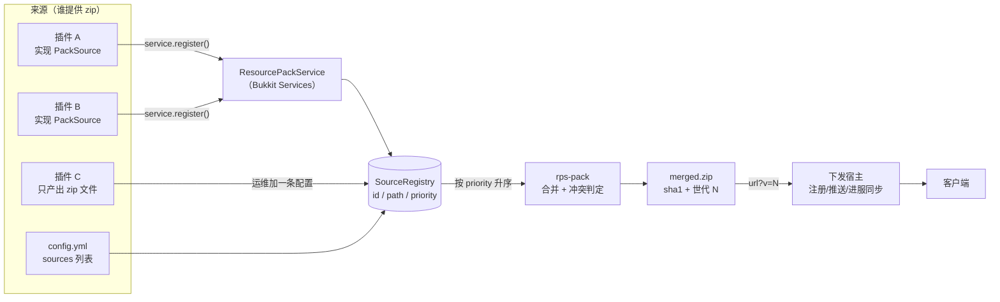
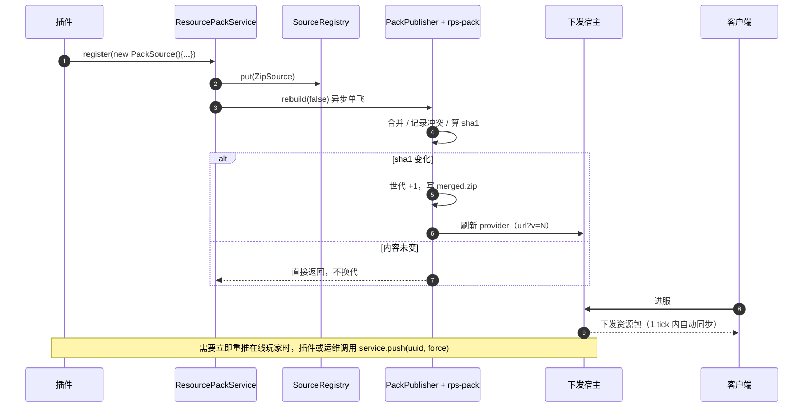
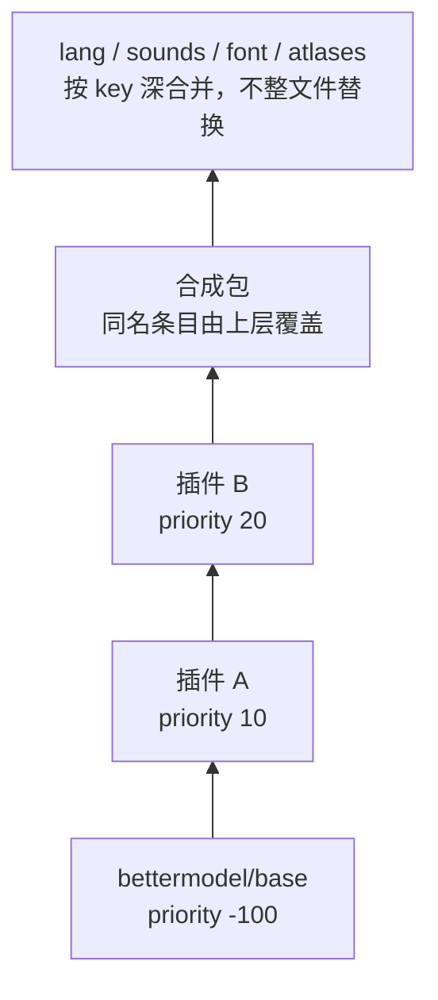

# 接入方式详解

本服务只做两件事：把各插件产出的 zip 合成一个，再交给下发宿主推送。接入方式按
"你的插件能不能改代码" 与 "是否要求开箱即用" 分成四种，另有两条反例。

## 0. 一张图看清数据流



关键点：**所有来源最终都落到同一张注册表**，因此四种接入方式可以混用；优先级决定层序，
不决定"谁能发包"。

## 1. 模式一：插件自己实现 PackSource（推荐）

适用：插件自己生成资源包（模型、音效、UI 材质），愿意加十几行代码。

```java
public final class YourPlugin extends JavaPlugin {
    private ResourcePackService service;

    @Override
    public void onEnable() {
        service = getServer().getServicesManager().load(ResourcePackService.class);
        if (service == null) {
            getLogger().warning("Resource Pack Service 未安装，资源包不会合入");
            return;
        }
        service.register(new PackSource() {
            @Override public String id() { return "yourplugin"; }
            @Override public Path file() { return getDataFolder().toPath().resolve("build.zip"); }
            @Override public int priority() { return 10; }
        });
    }

    @Override
    public void onDisable() {
        if (service != null) {
            service.unregister("yourplugin");
        }
    }
}
```

要点：

- `register` 会触发一次**异步重建**，不阻塞主线程；重复注册同 id 即替换。
- 内容更新后重新 `register` 一次即可；**版本号由本服务统一递增**，插件不用自己维护。
- `onDisable` 记得 `unregister`：来源指向的文件若被删，构建会失败并保留上一版。
- 只合并**本地文件**。远程 CDN 地址请先下载到本地再注册（见模式四）。

## 2. 模式二：插件产出的是目录，不是 zip

适用：插件把材质写在 `plugins/YourPlugin/assets/...`，没有打包能力。

两种做法：

1. 插件内用 `ZipOutputStream` 打成 zip 再注册（推荐，构建时机可控）。
2. 交给运维：把目录打成 zip 后写进 `config.yml` 的 `sources`，走模式三。

不要直接把目录塞进 `PackSource.file()`——合并器只接受 zip。

## 3. 模式三：零代码，运维侧配置

适用：插件是第三方闭源包，只在那台服务器上产出文件（例：`plugins/BetterModel/build.zip`）。

```yaml
sources:
  - id: "bettermodel/base"
    enabled: true
    path: "plugins/BetterModel/build.zip"   # 相对服务器根目录
    priority: -100                          # 越小越靠底层
    namespaces: ["bettermodel"]             # 仅用于报告
```

保存后 `/rps reload`，或等 `watch` 轮询到文件 mtime 变化自动重建。

要点：

- 同一 id 又被插件注册时，**插件注册的优先**（reload 后会把注册来源重新投回）。
- 轮询覆盖所有来源（配置 + 插件注册），间隔由 `watch.interval-seconds` 决定。
- 适合"文件由别的插件重写"的场景，例如对方 `/reload` 后重写 `build.zip`。

## 4. 模式四：只有远程地址

当前合并层只读本地文件，**不支持直接给 URL**。两条路：

1. 插件先下载到 `getDataFolder()/cache.zip`，校验后注册（推荐，插件自己知道更新时机）。
2. 提 Issue 说明需求，后续版本加 `RemoteSource`（列表、缓存、失败保旧）。

## 5. 模式五：提 PR，让来源开箱即用

适用：希望"装上就能用"，不要求运维写配置。

在 `config.yml` 的 `sources:` 加默认条目，附最小 zip 测试，提 PR；合入后随下一个
发行版本发布。流程见 [CONTRIBUTING.md](../CONTRIBUTING.md)。

## 6. 反例：不要做的事

| 做法 | 后果 |
|---|---|
| 自己调 `Player#setResourcePack` | 与宿主抢下发权，玩家可能装两份或在进服时被顶掉 |
| 另注册一个宿主 provider | 合成包被自己的包顶掉，等于绕过了合并 |
| 直接改 `server.properties` 的 `resource-pack` | 原版会在配置阶段抢先推旧包，且派生出第二个 UUID |
| 在 `sources` 里填远程 URL | 合并器只接受本地 zip，会构建失败并保留旧版 |

## 7. 注册、合并、下发时序



## 8. 层序与冲突



- 同路径内容相同 → 去重，不记冲突。
- 同路径内容不同 → 高优先级胜，`MergeResult.conflicts` 记录 winner/losers。
- `merge.policy: strict` 时冲突直接失败并保留上一版，适合宁可不下发也不下发错包的场景。
- `pack.mcmeta` 不参与合并：按所有来源的 `pack_format` 取交集重建。

## 9. 怎么选

| 你的情况 | 选 |
|---|---|
| 能改代码、自己产 zip | 模式一 |
| 只能产目录 | 模式二（自己打包）或模式三 |
| 闭源、文件由它自己重写 | 模式三 |
| 只有远程 URL | 先下载到本地再注册（模式四） |
| 想开箱即用、愿意提 PR | 模式五 |
