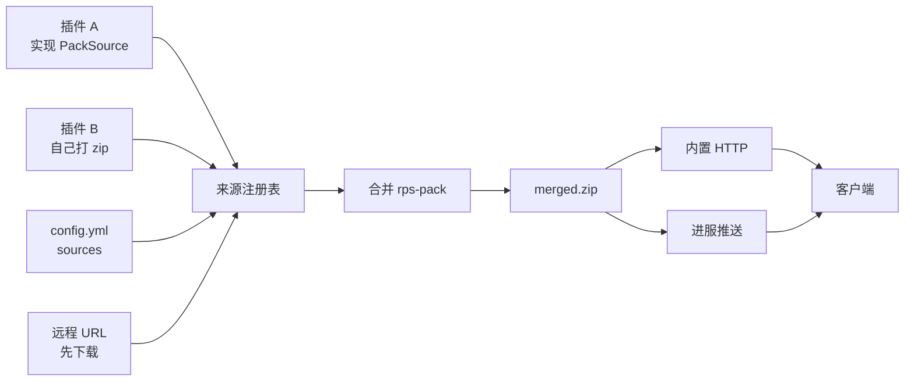

# 接入方式

本服务只认一件事：**一个本地 zip 文件**。谁产出、怎么产出、什么时候更新都不限制；
服务负责把它和其它来源合成一份，再统一下发。

下面按“改动量从大到小”列四种接入方式。选一种即可，不要同时用两种往同一个客户端发包。

## 数据流



无论哪条路，最终只有本服务调用 `setResourcePack`。客户端一个连接只保留一个服务端包。

## 方式一：插件实现 PackSource（推荐）

适合“资源包由插件自己生成、内容会跟着插件状态变”的场景。

### 1. 编译期依赖

在插件项目里把本服务的 jar 作为 `compileOnly`：

```kotlin
dependencies {
    compileOnly(files("libs/resource-pack-service-0.1.0.jar"))
}
```

运行期不需要把本服务打进你的 jar；它由服务端单独安装。

### 2. 实现来源

```java
import java.nio.file.Path;
import java.util.List;
import moe.nekomc.resourcepack.api.PackSource;

public final class CosmeticsPack implements PackSource {
    private final Path file;

    public CosmeticsPack(Path file) {
        this.file = file;
    }

    @Override public String id() { return "myplugin/cosmetics"; }
    @Override public Path file() { return file; }
    @Override public int priority() { return 100; }
    @Override public List<String> namespaces() { return List.of("myplugin"); }
}
```

- `id` 全局唯一，建议 `插件名/用途`。和配置里的来源同 id 时，你注册的会覆盖配置。
- `file` 每次构建时读取。文件不存在会让这次构建失败并保留上一版，不会发空包。
- `priority` 越大越靠上层；同路径冲突时上层赢。
- `sha1` 默认 null，由服务计算；只有你自己缓存了哈希且能保证一致时才覆盖。
- `namespaces` 只用于 `/rps list` 与冲突报告，不改变合并。

### 3. 注册与注销

```java
import moe.nekomc.resourcepack.api.ResourcePackService;
import org.bukkit.Bukkit;

ResourcePackService service = Bukkit.getServicesManager().load(ResourcePackService.class);
if (service == null) {
    getLogger().warning("没有安装 Resource Pack Service，资源包不会统一下发");
    return;
}

service.register(new CosmeticsPack(getDataFolder().toPath().resolve("pack.zip")));

// onDisable
service.unregister("myplugin/cosmetics");
```

`register` 会立即触发一次异步重建。如果 zip 是异步生成的，等生成完再调一次
`service.rebuild(false)`；`announce=true` 会按 `push.mode` 通知在线玩家。

需要立刻让某个玩家重载：

```java
service.push(player.getUniqueId(), false); // force=false 走普通重载
```

### 4. zip 里放什么

```text
pack.zip
  pack.mcmeta            # 可选；不带就不限制 pack_format
  assets/myplugin/...    # 必须放在自己的命名空间下
```

- 命名空间不要用 `minecraft`，也不要用别人的。
- 不带 `pack.mcmeta` 时，服务会把它当作“不限制格式”，条目照常合入。
- 带了 `pack.mcmeta` 时，`pack_format` / `supported_formats` 会参与所有来源的交集计算；
  交集为空则整次构建失败。
- 不需要自己写 `pack.mcmeta` 的 `description`，服务会统一重建。

## 方式二：插件自己打 zip，再登记路径

适合“插件已经在产目录/文件，但不想引入编译依赖”的场景。

```java
Path dir = getDataFolder().toPath().resolve("generated");
Path zip = getDataFolder().toPath().resolve("pack.zip");

try (ZipOutputStream out = new ZipOutputStream(Files.newOutputStream(zip))) {
    out.setLevel(Deflater.BEST_COMPRESSION);
    try (Stream<Path> walk = Files.walk(dir)) {
        for (Path path : walk.filter(Files::isRegularFile).sorted().toList()) {
            String name = dir.relativize(path).toString().replace('\\', '/');
            ZipEntry entry = new ZipEntry(name);
            entry.setTime(315532800000L); // 1980-01-01，固定时间戳
            out.putNextEntry(entry);
            Files.copy(path, out);
            out.closeEntry();
        }
    }
}

service.register(new CosmeticsPack(zip));
```

注意：

- 路径分隔符必须是 `/`，不要用 Windows 的 `\\`。
- 时间戳固定，内容不变时 sha1 才不变；否则每次都会全服重下。
- 目录里不要把缓存、日志、源文件打进去。
- 大文件先自己压缩；服务只做合并，不做纹理压缩。

## 方式三：只改 config.yml（零代码）

适合“插件已经把 zip 落在固定路径”，或者运维手工放包。

```yaml
sources:
  - id: "bettermodel/base"
    enabled: true
    path: "plugins/BetterModel/build.zip"
    priority: -100
    namespaces: ["bettermodel"]

  - id: "community/seasonal"
    enabled: true
    path: "plugins/ResourcePackService/community/seasonal.zip"
    priority: 10
```

社区目录里的包通常不需要写进 `sources`：插件会按 `manifest.json` 与已安装插件自动筛选。只有确实要绕过绑定、把某个独立 zip 当普通来源时才这样写。

改完：

```text
/rps reload
/rps status
/rps list
```

`path` 相对服务端根目录。文件不存在时构建失败并保留上一版；`/rps status` 会显示原因。
如果对方插件会重写这个 zip（例如 `/bettermodel reload` 重建 `build.zip`），
可以开启 `watch` 让服务轮询 mtime，或在对方重写后执行 `/rps build`。

## 方式四：只有远程 URL

服务不主动下载 URL。远程包必须先落到本地：

```bash
curl -fL --retry 3 -o plugins/Resource\ Pack\ Service/remote.zip \
  https://example.com/pack.zip
```

然后按方式二或方式三登记本地路径。原因：

- 构建必须确定性、可离线复现；
- 远程地址可能在构建时不可达，不能把服务器启动绑在外部网络上；
- 避免 SSRF 与“下载到一半”的半成品。

如果远程包由 CDN 托管且你只想改下载地址，不需要把它当来源：把合成结果同步到 CDN，
再设置 `delivery.http.public-url` 即可。

## 方式五：把包提进仓库（社区资源包）

适合公开分发的材质包。按 `packs/<id>/` 放 `pack.yml`、`pack.mcmeta`、
`assets/<namespace>/`，并在 `pack.yml` 里声明 `plugin`、`relation`、`release`。
提 PR 后由机器人校验、预览；合并进 `main` 后不会因为新增包就自动发行，
第一次需要维护者在 Auto Release 的 `force_packs` 里批准。规范见
[packs/README.md](../packs/README.md)。

## Fabric 服务端

Fabric 版与 Paper 版共用同一套内核（`:core`），但**没有对外注册入口**：`ResourcePackService` 在 Paper 侧通过
`ServicesManager` 注册（`paper/src/main/java/moe/nekomc/resourcepack/ResourcePackServicePlugin.java:151`），
Fabric 没有等价机制，`FabricPlatform` 只在内部装配来源。

因此 Fabric 服务端上，给本服务供包只能用 `config/resource-pack-service/config.yml` 的 `sources`（即「方式三」），
不能在代码里 `register`。要在 Fabric 上补同等 API，需要在 `RpsFabricMod` 里加自定义事件或暴露 mod 级入口，目前没有做。

两个版本的 jar 都内置 `moe.nekomc.resourcepack.api`，编译期依赖任选其一即可；只有 Paper 运行期能通过 `ServicesManager` 取到实现。

## 选型表

| 场景 | 选哪种 | 原因 |
| --- | --- | --- |
| 插件自己生成材质，随状态变化 | 方式一 | 注册即触发重建，生命周期清晰 |
| 插件产目录，不想加编译依赖 | 方式二 | 自己打 zip，只登记路径 |
| 插件已产固定 zip，运维接手 | 方式三 | 零代码，改配置即可 |
| 包在远程/CDN | 方式四 | 先本地化，保证构建可复现 |
| 公开材质包，想走 PR 流程 | 方式五 | 自动校验与发版 |

## 冲突处理

### 路径冲突

两个来源有同一个 `assets/...` 路径且内容不同：

| `merge.policy` | 结果 |
| --- | --- |
| `override`（默认） | 高优先级覆盖低优先级 |
| `first` | 低优先级保留 |
| `strict` | 构建失败，报告冲突路径与来源 |

`/rps list` 看优先级，`/rps status` 看最近一次构建的冲突摘要，`/rps diff` 看条目变化。

### 命名空间冲突

两个插件都用 `assets/myplugin/`：不会报错，但会互相覆盖。约定：

- 命名空间用插件名小写；
- 公共库（如通用 UI 材质）单独占一个命名空间，不要塞进业务命名空间；
- 在 `namespaces` 里声明，便于 `/rps list` 发现撞车。

### 与其它下发插件冲突

| 对方行为 | 结果 | 处置 |
| --- | --- | --- |
| 只产 zip，不推送 | 不冲突 | 加进 `sources` 或让它注册 |
| 自己调 `Player#setResourcePack` | 后发者覆盖，客户端只剩一个包 | 关掉对方推送，只保留文件；`/rps check` 会扫可疑配置 |
| 调用别的下发 API 注册 provider | 对方可能整包顶掉合成包 | 关掉对方注册，或让它的来源改走本服务 |
| 原版 `server.properties` 配了 `resource-pack` | 配置阶段抢先推旧包 | 两项清空 |

本服务不拦截别人的 `setResourcePack`，也拿不到“谁最后发”的事件；只能靠部署时保证
只有一个出口。`/rps check` 是发现问题的第一道闸，不是运行时仲裁。

## 反例

- ❌ 自己写 `PlayerJoinEvent` 再 `setResourcePack`：和本服务抢同一个客户端包。
- ❌ 把远程 URL 直接写进 `sources.path`：服务只读本地文件。
- ❌ 在来源 zip 里塞 `pack.mcmeta` 并指望它生效：会被丢弃后统一重建。
- ❌ 每次构建都写当前时间戳：sha1 每次都变，全服反复重下。
- ❌ 用 `minecraft` 命名空间：和原版资源冲突，升级时必炸。
